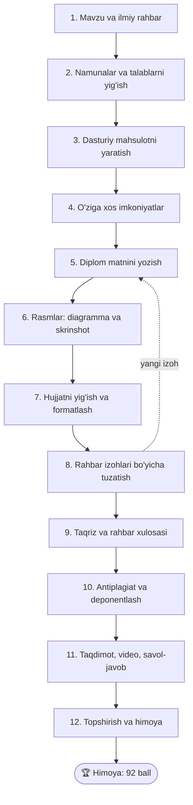

# 🎓 Diplom loyihasi: g'oyadan himoyagacha

> **Mavzu:** “Real vaqtda xabar almashish imkonini beruvchi “Milliy” xabarchi ishlab chiqish”
>
> **Muallif:** Sohinazarov Sardor · **Universitet:** TATU, “Dasturiy injiniring” fakulteti, “Tizimli va amaliy dasturlashtirish” kafedrasi
>
> **Ishlab turgan dastur:** [qales.uz](https://qales.uz) · **Diplom sayti:** [diplom.qales.uz](https://diplom.qales.uz)
>
> 🏆 **Diplom muvaffaqiyatli himoya qilindi — 92 ball.**

Bu repozitoriyda diplom loyihasining **hamma narsasi** bor: dastur kodi, diplom matnini yig'adigan generator, rasmlar, taqdimot va topshiriladigan hujjatlar.

README ikki maqsadda yozilgan:

1. **Nima qilinganini** bir joyda ko'rsatish.
2. **Har qanday talabaga** diplom ishi qanday tayyorlanishi va topshirilishini bosqichma-bosqich tushuntirish. Qadamlar shu loyihada haqiqatda bosib o'tilgan yo'l asosida yozilgan.

---

## 📌 Qisqacha natija

| Ko'rsatkich | Qiymat |
|---|---|
| **Himoya natijasi** | **92 ball** ✅ |
| Diplom hajmi | 94 bet: kirish, 4 bob, xulosa, 5 ta ilova |
| Adabiyotlar | 31 ta manba |
| Avtomatik testlar | 810 ta (server 457, klient 353) |
| Rasmlar va jadvallar | 41 ta rasm (diagramma va skrinshotlar), 17 ta jadval |
| Himoya taqdimoti | 19 ta asosiy slayd + 11 ta zaxira slayd |
| Joylashtirish | VPS, Docker Compose, Caddy (HTTPS), GitHub Actions |
| Amaliy joriy etish | Elektron kooperatsiya portalidagi kompaniyalararo chat |
| Deponentlash | im.adliya.uz uchun deponentlangan material tayyorlandi |

---

## 🗺️ Umumiy yo'l xaritasi



> 💡 **Eng muhim saboq:** diplom bir martada yozilmaydi. 8-bosqichdan keyin 5–7-bosqichlarga bir necha marta qaytiladi. Shuning uchun hujjatni **qayta yig'ish oson** bo'ladigan qilib tayyorlang (pastda, 7-bosqichga qarang).

---

## 📅 Bu loyihaning xronologiyasi

Sanalar git tarixidan olingan.

| Sana | Nima qilindi |
|---|---|
| 2026-09-26 | Generator, kod repolari (submodul), rasmlar, diplomning birinchi varianti (146 bet) va taqdimot |
| 2026-09-29 | Rasmiy ma'lumotlar (mavzu, kafedra, rahbar, guruh). Hajm 146 → 82 betga qisqartirildi. Matnga adabiyotlarga havolalar qo'shildi |
| 2026-09-29 | Taqriz va rahbar xulosasi generatori |
| 2026-10-06 | BMI himoyasi uchun birinchi taqdimot |
| 2026-10-15 — 16 | Dasturga yangi imkoniyatlar: forum, reaksiyalar, bloklash, maxfiy chat |
| 2026-10-17 | **Ilmiy rahbarning 14 ta izohi** bo'yicha diplom qayta generatsiya qilindi |
| 2026-10-17 — 19 | Sekin internetga moslashuv, 360p video, kun/tun rejimi; HFX bobidan hisob-kitoblar olib tashlandi |
| 2026-10-19 | **Tashqi taqriz** olindi. Butun matn sodda tilga o'tkazildi; Humo messenjeri bilan solishtirish va ustunliklar qo'shildi |
| 2026-10-20 | Xulosa bir betga sig'dirildi, nofunksional talablar, yangi manbalar |
| 2026-11-14 | Haqiqiy joylashtirish (VPS) yozildi, testlar qayta sanaldi |
| 2026-11-16 | Paragraflar raqamlanishi (1.1., 2.1.), adabiyotlar 43 → 31 |
| 2026-11-19 | Qisqa himoya taqdimoti, deponentlangan material, namoyish videosi ssenariysi |
| **Himoya** | 🏆 **Diplom loyihasi himoya qilindi — 92 ball** |

---

## 🪜 Bosqichma-bosqich yo'riqnoma

### 1. Mavzu va ilmiy rahbar

- Mavzuni **o'zingiz qila oladigan va ko'rsata oladigan** narsadan tanlang. Ishlaydigan dastur himoyada eng kuchli dalil.
- Mavzuning **rasmiy nomini** buyruqdagidek, harfma-harf yozib oling. U titulda, topshiriq varag'ida, annotatsiyada, rahbar xulosasida, taqrizda va taqdimotda bir xil bo'lishi shart.
- Kafedra, guruh, rahbar va maslahatchilarning (HFX/BJD va boshqalar) to'liq F.I.Sh. va lavozimlarini bitta joyga yozib qo'ying.

### 2. Namunalar va talablarni yig'ish

Ishni boshlashdan oldin [`examples/`](examples/) papkasiga oldingi yillardagi namunalar yig'ilgan:

| Fayl | Nima uchun kerak |
|---|---|
| `diplom ishi *.pdf / .docx` | Tuzilma, titul, mundarija, rasmiylashtirish namunasi |
| `taqriz.pdf`, `rahbar xulosasi.pdf` | Bu hujjatlar qanday ko'rinishda bo'lishi |
| `BMI presentation.pptx` | Himoya taqdimoti namunasi |
| `antiplagat.jpg` | Antiplagiat ma'lumotnomasi namunasi |
| `GUVOHNOMA.pdf` | Dasturni ro'yxatdan o'tkazish guvohnomasi namunasi |
| `gpa.pdf` | O'zlashtirish ko'rsatkichi hujjati |

> ✅ Kafedradan **rasmiylashtirish talablarini** (shrift, interval, hoshiyalar, bet soni, bob tuzilmasi) yozma ko'rinishda oling. Keyin taxmin qilib o'tirmaysiz.

### 3. Dasturiy mahsulotni yaratish

Kod alohida repolarda saqlanadi va bu yerga **git submodule** sifatida ulangan:

| Papka | Nima | Texnologiya |
|---|---|---|
| [`NationalChat/`](NationalChat/) | Server | .NET 8, ASP.NET Core, EF Core, PostgreSQL, SignalR |
| [`NationalChatClient/`](NationalChatClient/) | Veb-klient | Angular, Vitest |

Tavsiyalar:

- **Testlar yozing.** Diplomda “810 ta avtomatik test” degan raqam sifat haqidagi har qanday so'zdan kuchli.
- **Saytni internetga chiqaring.** Himoyada jonli ko'rsatish mumkin, komissiya telefonidan ham ochib ko'ra oladi.
- **Faqat bor narsani yozing.** Kodda yo'q imkoniyat diplomda “keyingi bosqich” deb yoziladi, “qilindi” deb emas. Savol berilganda bu sizni qutqaradi.

### 4. O'ziga xos imkoniyatlar

Komissiyaning birinchi savoli: **“Telegram bor-ku, buning nima keragi bor?”** Bunga javob dasturning o'zida bo'lishi kerak. Bu loyihada ([REJA-ustunliklar.md](REJA-ustunliklar.md)):

- lotin ↔ kirill avtomatik o'girish (ko'rsatish va qidiruvda);
- tashkilot rejimi (ish e-pochtasi orqali tasdiqlash);
- maxfiy chatlar — uchdan-uchgacha shifrlash;
- forum, lavhalar, sekin internetga moslashuv;
- o'z serverida ishlash va boshqa tizimlarga ulanish (Elektron kooperatsiya portali).

Mahalliy raqobatchi (Humo) bilan **xolis** solishtirish jadvali ham qo'shildi. Aniqlanmagan katakka “Ma'lumot yo'q” yoziladi, taxmin qilinmaydi.

### 5. Diplom matnini yozish

Hujjat tuzilmasi va unga mos generator modullari:

| Qism | Fayl | Izoh |
|---|---|---|
| Titul, topshiriq varag'i | `content/00-front.mjs` | Rasmiy ma'lumotlar |
| Annotatsiya (o'zbek, rus, ingliz) | `content/01-annotation.mjs` | Uchala til **bitta betga** sig'adi |
| Kirish | `content/02-kirish.mjs` | Dolzarblik, maqsad, vazifalar, amaliy ahamiyat, hajm |
| I bob — tahlil | `content/10-bob1.mjs` | Mavjud messenjerlar, solishtirish, talablar |
| II bob — loyihalash | `content/20-bob2.mjs` | Arxitektura, ma'lumotlar bazasi, ketma-ketlik diagrammalari |
| III bob — amalga oshirish | `content/30-bob3.mjs` | Interfeys, testlar, joylashtirish, joriy etish |
| IV bob — HFX | `content/40-bob4-hfx.mjs` | Ish joyi ergonomikasi, yong'in xavfsizligi |
| Xulosa | `content/90-xulosa.mjs` | Bir bet, aniq natijalar |
| Adabiyotlar | `content/91-adabiyotlar.mjs` | Har bir manba matnda kamida bir marta `[n]` bilan keltirilgan |
| Ilovalar | `content/92-ilovalar.mjs` | Muhim kod parchalari |

**Yozish qoidalari** (taqrizdan keyin qabul qilingan, [REJA-RTM-taqriz.md](REJA-RTM-taqriz.md)):

- Avval **“nima uchun”**, keyin **“qanday”**.
- Bitta jumla — bitta fikr.
- Kod nomlari (DTO, middleware, IQueryable) matnda emas, jadval va ilovalarda bo'ladi.
- Matnni dasturchi bo'lmagan komissiya a'zosi ham tushunishi kerak.
- Har bir bobda 3 tadan ortiq kichik bo'lim bo'lmaydi (rahbar talabi).
- Boblar ichida kod kam, to'liq kod ilovada.

### 6. Rasmlar: diagrammalar va skrinshotlar

- **Diagrammalar** Mermaid matni sifatida yoziladi (`diagrams/*.mmd`) va avtomatik PNG ga aylantiriladi (`tools/render-diagrams.mjs`). Matnni o'zgartirsangiz, rasm o'zi yangilanadi.
- **Skrinshotlar** ham avtomatik olinadi: `tools/seed.mjs` test serverni namunaviy ma'lumotlar bilan to'ldiradi, `tools/screenshots.mjs` esa brauzerda kerakli ekranlarni suratga oladi. Dastur o'zgarsa, hamma skrinshot bir buyruq bilan qayta olinadi.
- Rasmlar faqat **tik** betda bo'ladi. Rasm sig'masa, oldingi betda katta bo'sh joy qolmasligi kerak (`tools/fit-pages.mjs` buni avtomatik tuzatadi).

### 7. Hujjatni yig'ish va formatlash

Diplom Word'da qo'lda emas, **kod orqali** yig'iladi ([`diplom/generator/`](diplom/generator/)). Afzalligi: mundarija, rasm, jadval va bet raqamlari har safar to'g'ri chiqadi, rahbar izohidan keyin qayta yig'ish bir necha soniya oladi.

```powershell
git clone --recurse-submodules https://github.com/SardorSohinazarov/diplom-ish.git
```

```powershell
cd diplom-ish/diplom/generator; npm ci
```

| Vazifa | Buyruq |
|---|---|
| Diplomni yig'ish (`.docx`) | `node build.mjs` |
| Bitta bobni tez ko'rish | `node build.mjs --only bob3` |
| PDF (Word kerak, mundarijani ham yangilaydi) | `powershell -File tools/export-pdf.ps1 ..\Diplom_ishi_Sohinazarov_Sardor.docx ..\Diplom_ishi_Sohinazarov_Sardor.pdf` |
| Diagrammalarni chizish | `node tools/render-diagrams.mjs` |
| Rahbar xulosasi | `node hujjatlar.mjs` |
| Deponentlangan material | `node deponent.mjs` |
| To'liq taqdimot | `node slides.mjs` |
| Himoya taqdimoti | `node slides-himoya.mjs` |
| Diplom sayti (diplom.qales.uz) | `node site.mjs` → `diplom/sayt/` |
| Taqdimotni PDF ga | `powershell -File tools/export-slides.ps1 ../Taqdimot_Sohinazarov_Sardor.pptx <png-papka> ../Taqdimot_Sohinazarov_Sardor.pdf` |
| Betlarni ko'z bilan tekshirish | `node tools/pdf-pages.mjs ...` → `node tools/contact-sheet.mjs ...` |

> ⚠️ **Diqqat:** yakuniy `Diplom_ishi_*.docx` WPS'da qo'lda formatlangan. Endi uni `build.mjs` bilan qayta yaratish qo'lda qilingan formatlashni o'chirib yuboradi. Kichik tuzatishlar to'g'ridan-to'g'ri hujjatning o'zida qilinadi.

> 💡 Generator yozish shart emas. Oddiy Word'da yozsangiz ham, **sarlavha uslublari (Heading 1/2/3)**, avtomatik mundarija va avtomatik rasm/jadval raqamlaridan foydalaning. Qo'lda raqam qo'ymang.

### 8. Ilmiy rahbar izohlari bo'yicha tuzatish

Rahbar 14 ta izoh berdi ([REJA-rahbar-izohlari.md](REJA-rahbar-izohlari.md)). Ko'p uchraydiganlari:

- annotatsiya qisqa va uchala tilda bitta betda bo'lsin;
- “Bitiruv malakaviy ishi” emas, **“Diplom loyihasi”** deb yozilsin (hamma hujjatda);
- mundarijada har bo'limda ko'pi bilan 3 ta kichik bo'lim;
- rasmlar betga sig'sin, albom (yotiq) bet ishlatilmasin;
- adabiyotlardan standartlar (GOST, ISO) olib tashlansin, mavzuga oid kitoblar qo'shilsin;
- boblar ichidagi kod parchalari kamaytirilsin;
- III bob hajmi kattaroq, butun hujjat ~100 bet atrofida bo'lsin;
- HFX bobidan ortiqcha hisob-kitoblar olib tashlansin.

**Ish tartibi:** avval izohlarni alohida faylga yozib oling → reja tuzing → hammasini bitta martada qo'llang → ko'z bilan tekshiring → rahbarga qayta yuboring.

### 9. Taqriz va rahbar xulosasi

- **Taqriz** tashqi tashkilot mutaxassisidan olinadi. Bu yerda u taqrizchining o'z fayli sifatida saqlangan ([`diplom/Taqriz_Sohinazarov_Sardor.docx`](diplom/Taqriz_Sohinazarov_Sardor.docx)) va **o'zgartirilmaydi**.
- Taqrizdagi izohlar ham diplomga kiritiladi. Bu loyihada taqrizdan keyin butun matn sodda tilga o'tkazildi.
- Taqrizda yozilgan raqamlar va faktlar diplomdagilar bilan **mos** ekanini tekshiring.
- **Rahbar xulosasi** ([`Rahbar_xulosasi_*.docx`](diplom/Rahbar_xulosasi_Sohinazarov_Sardor.docx)) bir bet. Uni rahbar imzolaydi.

### 10. Antiplagiat va deponentlash

- **Antiplagiat:** yakuniy matn tizimdan o'tkaziladi va ma'lumotnoma olinadi (namuna: `examples/antiplagat.jpg`). Matnni o'z so'zlaringiz bilan yozsangiz, bu bosqich muammosiz o'tadi. Shablon ta'riflarni ko'chirmang, ayniqsa HFX bobida.
- **Deponentlash:** dastur [im.adliya.uz](https://im.adliya.uz) da ro'yxatdan o'tkaziladi. Buning uchun titul va asosiy manba fayllaridan iborat **deponentlangan material** tayyorlanadi (`node deponent.mjs` → [`Deponentlangan_material_Milliy.pdf`](diplom/Deponentlangan_material_Milliy.pdf)). Natijada guvohnoma beriladi (namuna: `examples/GUVOHNOMA.pdf`).

### 11. Taqdimot, video va savol-javob

- **Taqdimot** ([`Himoya_taqdimoti_*.pptx`](diplom/Himoya_taqdimoti_Sohinazarov_Sardor.pptx)): 19 ta asosiy slayd — muammo, maqsad, solishtirish, arxitektura, o'ziga xos imkoniyatlar, jonli namoyish, dasturni ro'yxatdan o'tkazish, natijalar, rahmat (QR-kod bilan).
- **Zaxira slaydlar** oxirida turadi: kutilgan savollarga tayyor javob (maxfiy chat qanday ishlaydi, nega SignalR, xavfsizlik va h.k.).
- **Namoyish videosi** ([`Video-ssenariy.md`](diplom/Video-ssenariy.md)): internet uzilsa, jonli namoyish o'rniga ko'rsatiladi. ~75 soniya, ovozsiz, ustidan o'zingiz gapirasiz.
- Taqdimotni **ovoz chiqarib, vaqt o'lchab** kamida 3 marta mashq qiling (odatda 7–10 daqiqa beriladi).

### 12. Topshirish va himoya

#### 📂 Topshiriladigan hujjatlar

| Hujjat | Fayl |
|---|---|
| Diplom loyihasi (imzolangan, tikilgan) | [`Diplom_ishi_Sohinazarov_Sardor.pdf`](diplom/Diplom_ishi_Sohinazarov_Sardor.pdf) |
| Ilmiy rahbar xulosasi | [`Rahbar_xulosasi_Sohinazarov_Sardor.pdf`](diplom/Rahbar_xulosasi_Sohinazarov_Sardor.pdf) |
| Tashqi taqriz | [`Taqriz_Sohinazarov_Sardor.pdf`](diplom/Taqriz_Sohinazarov_Sardor.pdf) |
| Antiplagiat ma'lumotnomasi | kafedradan olinadi |
| Deponentlash guvohnomasi | im.adliya.uz |
| Himoya taqdimoti | [`Himoya_taqdimoti_Sohinazarov_Sardor.pptx`](diplom/Himoya_taqdimoti_Sohinazarov_Sardor.pptx) |
| Elektron nusxa | PDF + PPTX, fleshkada va bulutda |

#### ✅ Himoya kuni tekshiruv ro'yxati

- [ ] Taqdimot fleshkada, bulutda va pochtada — uch joyda
- [ ] Sayt ochilishi himoyadan oldin tekshirildi, namoyish hisoblari tayyor
- [ ] Namoyish videosi taqdimot ichida (internet bo'lmasa)
- [ ] Diplomning bosma nusxasi, barcha imzolar qo'yilgan
- [ ] Zaxira slaydlardagi savollarga javoblar takrorlandi
- [ ] Diplomdagi asosiy raqamlar yod: bet soni, testlar soni, manbalar soni

---

## 🌐 Diplom sayti: diplom.qales.uz

Himoyadan keyin diplom haqidagi ma'lumot internetda topilishi uchun alohida sayt qilindi. Uni Google'dan qidirgan odam ham, ChatGPT yoki Claude kabi AI yordamchilar ham o'qiy oladi.

- Asosiy sahifa o'zbekcha. Unda annotatsiya (3 tilda), maqsad va vazifalar, imkoniyatlar, arxitektura, mundarija, natijalar va savol-javob bor. Inglizcha (`/en/`) va ruscha (`/ru/`) qisqa variantlari ham bor.
- Bu yo'riqnoma ham saytda turadi: `/yoriqnoma/`.
- Diplom PDF va himoya taqdimotini saytdan yuklab olish mumkin. Taqriz va rahbar xulosasi saytga qo'yilmagan.
- Qidiruv tizimlari uchun JSON-LD (Thesis, SoftwareApplication, FAQPage), `sitemap.xml` va `robots.txt` bor.
- AI yordamchilar uchun `llms.txt` (qisqa mazmun) va `llms-full.txt` (diplomning to'liq matni) bor.
- Sayt `diplom/generator/site.mjs` bilan yaratiladi. `master`ga push qilinganda GitHub Actions uni yig'adi, Docker image qilib VPS'ga joylaydi ([deploy-site.yml](.github/workflows/deploy-site.yml)).

> 💡 Talabalarga: diplomingiz uchun bitta oddiy sahifa qilib qo'ying, unda annotatsiya, PDF va ishlab turgan dastur havolasi bo'lsin. Ish beruvchi yoki magistratura komissiyasi sizni qidirganda, birinchi bo'lib shu sahifa chiqadi.

---

## 📁 Repozitoriy tuzilishi

```text
diplom-ish/
├── README.md                  ← shu fayl
├── deploy/                    ← diplom.qales.uz uchun Docker va Caddy fayllari
├── NationalChat/              ← server kodi (submodule)
├── NationalChatClient/        ← veb-klient kodi (submodule)
├── diplom/                    ← tayyor hujjatlar (docx, pdf, pptx)
│   ├── Video-ssenariy.md
│   └── generator/
│       ├── build.mjs          ← diplomni yig'adi
│       ├── slides*.mjs        ← taqdimotlar
│       ├── hujjatlar.mjs      ← rahbar xulosasi
│       ├── deponent.mjs       ← deponentlangan material
│       ├── site.mjs           ← diplom.qales.uz sayti
│       ├── content/           ← boblar matni
│       ├── diagrams/          ← Mermaid/SVG diagrammalar
│       ├── rasmlar/           ← tayyor rasmlar
│       ├── data/              ← namunaviy ma'lumotlar, test natijalari
│       └── tools/             ← PDF, skrinshot, tekshiruv skriptlari
├── examples/                  ← oldingi yillar namunalari
└── REJA-*.md, KEYINGI-QADAMLAR.md, DAVOM-ETTIRISH.md  ← ish jarayonidagi rejalar
```

---

## 🧠 Talabalarga 10 ta maslahat

1. **Ertaroq boshlang.** Rahbar izohlari va taqriz har biri kamida bir hafta oladi.
2. **Avval dastur, keyin matn.** Ishlamaydigan dastur haqida yaxshi matn yozib bo'lmaydi.
3. **Faqat haqiqatni yozing.** Yo'q imkoniyat — “keyingi bosqich”.
4. **Raqamlar bilan gapiring:** testlar soni, javob vaqti, foydalanuvchilar soni.
5. **Har bir izohni yozib boring** va bajarilganini belgilang (bu repodagi `REJA-*.md` fayllari kabi).
6. **Git ishlating.** Har bir katta o'zgarish alohida commit — eski variantga qaytish oson.
7. **Hajm sifat emas.** 146 betlik birinchi variant 82 betga qisqartirildi va yaxshiroq bo'ldi.
8. **Sodda yozing.** Komissiyada dasturchi bo'lmagan a'zolar ham bor.
9. **Raqobatchilarni xolis solishtiring** va o'z ustunligingizni aniq ayting.
10. **Zaxira rejangiz bo'lsin:** video, PDF nusxa, oflayn taqdimot.

---

<sub>Ish jarayonining batafsil qaydlari: [DAVOM-ETTIRISH.md](DAVOM-ETTIRISH.md) · [KEYINGI-QADAMLAR.md](KEYINGI-QADAMLAR.md) · [REJA-rahbar-izohlari.md](REJA-rahbar-izohlari.md) · [REJA-RTM-taqriz.md](REJA-RTM-taqriz.md) · [REJA-ustunliklar.md](REJA-ustunliklar.md)</sub>
